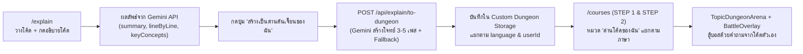

# Implementation Plan: ระบบแปลงโค้ดตัวเองเป็นคอร์สดันเจี้ยนส่วนตัว (My Code Dungeons)

## Goal Description
เพิ่มความสามารถให้ผู้เรียนนำโค้ดของตนเองที่ผ่านการวิเคราะห์จากหน้า **อธิบายโค้ด (`/explain`)** มาสร้างเป็น **ด่านดันเจี้ยนส่วนตัว (Custom Code Dungeon)** แยกตามภาษาโปรแกรมทั้ง 7 ภาษา (`JavaScript`, `TypeScript`, `Python`, `Java`, `C / C++`, `SQL`, `HTML / CSS`) แล้วนำไปแสดงและเล่นจริงในหน้า **ดันเจี้ยนการเรียนรู้ (`/courses`)** ผ่านระบบ `TopicDungeonArena` และ `BattleOverlay` ที่มีอยู่เดิม

---

## User Review Required

> [!IMPORTANT]
> **ข้อเสนอเพิ่มเติม (Recommendations) — โปรดเลือกส่วนที่ต้องการรวมในรอบนี้:**
> 1. **ปุ่ม "เข้าเล่นด่านนี้ทันที" หลังสร้างจากหน้า `/explain`:** สร้างเสร็จแล้วพาไป `/courses?lang=...&customFloor=...` เพื่อเริ่มเล่นได้เลยโดยไม่ต้องกลับไปหาเอง
> 2. **สร้างโจทย์ Bug Hunter (Modify Challenge) อัตโนมัติ:** ให้ Gemini สร้างโจทย์แก้ไขโค้ด 1 จุดจากโค้ดของผู้ใช้ด้วย เพื่อให้ด่านส่วนตัวมีเควสซ่อมโค้ดหลังชนะมอนสเตอร์เหมือนด่านหลัก (ใช้ได้กับภาษาที่รันในเบราว์เซอร์ได้ เช่น JavaScript)
> 3. **แชร์ด่านให้เพื่อนลองเล่น:** เพิ่มปุ่มคัดลอกรหัส/ลิงก์ด่าน หรือ Export เป็น JSON สำหรับส่งให้เพื่อนในห้องเรียน

---

## Proposed Architecture & Flow

---

## Proposed Changes

### 1. Data Model & Client Storage (`app/lib/custom-dungeon.ts`)

#### [NEW] [custom-dungeon.ts](file:///C:/Users/User/Documents/GitHub/explain-code/explain-code/app/lib/custom-dungeon.ts)
- กำหนดโครงสร้าง `CustomDungeonFloor`:
  - `id: string` (เช่น `"custom-<timestamp>"`)
  - `userId: string` (`session.userId` หรือ `"guest"`)
  - `language: LearningLanguage` (`javascript | typescript | python | java | cpp | sql | html`)
  - `title: string`, `subtitle: string`
  - `code: string`
  - `summary: string`, `keyConcepts: string[]`
  - `questions: DungeonQuestion[]` (3–5 เฟส: Predict Output, Trace Line, Purpose/Concept, Pitfall)
  - `cleared: boolean`, `bestScorePercent?: number`, `earnedXp?: number`, `createdAt: string`
- ฟังก์ชันจัดการ `localStorage` (`explain_code_custom_dungeons_v1`):
  - `loadCustomDungeons(userId: string, language?: LearningLanguage)`
  - `saveCustomDungeon(floor: CustomDungeonFloor)`
  - `markCustomDungeonCleared(userId: string, floorId: string, scorePercent: number, xp: number)`
  - `deleteCustomDungeon(userId: string, floorId: string)`
  - `toTopicQuest(floor: CustomDungeonFloor, index: number): TopicQuest` เพื่อแปลงเป็น `TopicQuest` สำหรับส่งเข้า `TopicDungeonArena` ได้ทันที

---

### 2. AI Question Generator API (`app/api/explain/to-dungeon/route.ts`)

#### [NEW] [route.ts](file:///C:/Users/User/Documents/GitHub/explain-code/explain-code/app/api/explain/to-dungeon/route.ts)
- รับ `{ code, language, title, explanation, uiLang }`
- ใช้ `process.env.GEMINI_API_KEY` เรียกโมเดล `gemini-3.5-flash-lite` (แบบเดียวกับ `explain-code.ts`) เพื่อสร้างชุดคำถามปรนัย 4 ตัวเลือก จำนวน 3–4 ข้อ จากโค้ดของผู้ใช้จริง ครอบคลุม:
  1. **Phase 1 · Code Structure / Syntax** (ระดับ Atom/Block)
  2. **Phase 2 · Execution & Trace** (ไล่ค่าตัวแปร / ผลลัพธ์)
  3. **Phase 3 · Purpose & Output** (หน้าที่ของโค้ด / เงื่อนไข)
  4. **Phase 4 · Pitfall & Edge Case** (จุดที่ต้องระวัง)
- **Deterministic Fallback Generator**: หาก Gemini ไม่พร้อม/timeout จะสร้างคำถามจาก `explanation.lineByLine`, `keyConcepts`, และ `potentialPitfalls` โดยอัตโนมัติ เพื่อให้สร้างด่านได้ 100% ทุกครั้งไม่มี error

---

### 3. หน้าอธิบายโค้ด (`app/explain/page.tsx`)

#### [MODIFY] [page.tsx](file:///C:/Users/User/Documents/GitHub/explain-code/explain-code/app/explain/page.tsx)
- เมื่อมีผลลัพธ์ `result` แสดงอยู่ฝั่งขวา เพิ่มการ์ด/ปุ่ม **"สร้างเป็นด่านดันเจี้ยนของฉัน (Save to My Dungeon)"**
- เปิด Modal ให้ตั้งชื่อด่าน (เติมค่าเริ่มต้นจาก `keyConcepts[0]` หรือชื่อฟังก์ชันในโค้ด)
- กดยืนยัน → เรียก `POST /api/explain/to-dungeon` → บันทึกลง `custom-dungeon.ts` → แสดงปุ่มลัด **"ไปเล่นด่านนี้เลย →"** ที่พาไปยัง `/courses?lang=${language}&customFloor=${newFloor.id}`

---

### 4. ดันเจี้ยนและหน้าการเรียนรู้ (`TopicDungeonArena.tsx` & `app/courses/page.tsx`)

#### [MODIFY] [TopicDungeonArena.tsx](file:///C:/Users/User/Documents/GitHub/explain-code/explain-code/app/components/dungeon/TopicDungeonArena.tsx)
- เพิ่ม optional prop `customQuestions?: DungeonQuestion[]`
- ใน `phaseQuestions`: ถ้ามี `customQuestions && customQuestions.length > 0` ให้ใช้ `customQuestions` แทน `getQuestionsForTopic(activeTopic, activeLanguage)`
- รักษาความสามารถทั้งหมดของดันเจี้ยน (เดินชนมอนสเตอร์, BattleOverlay, สกิลฮีโร่, Code Chest, Floor Code Scroll แสดงโค้ดตัวเอง)

#### [MODIFY] [page.tsx](file:///C:/Users/User/Documents/GitHub/explain-code/explain-code/app/courses/page.tsx)
- **STEP 1 (หน้าเลือกภาษา):**
  - แสดงจำนวนด่านโค้ดของฉันบนการ์ดแต่ละภาษา (เช่น `My Code: 2 ด่าน`)
  - เพิ่มบล็อก **"คลังดันเจี้ยนโค้ดของฉัน (My Code Dungeons)"** สำหรับกดเข้าเล่นด่านที่สร้างไว้ล่าสุดได้ทันที หรือกดไปหน้า `/explain` เพื่อสร้างเพิ่ม
- **STEP 2 (หน้าแผนที่ดันเจี้ยนของภาษาที่เลือก):**
  - เพิ่มส่วน **"ด่านโค้ดของฉัน (My Code Floors)"** แยกจากด่านหลักของภาษานั้น
  - รองรับ query param `?lang=...&customFloor=...` เพื่อเปิดเข้าเล่นด่านที่เพิ่งสร้างได้ทันที
  - เมื่อเคลียร์ด่านโค้ดของฉันใน `TopicDungeonArena` ให้บันทึก `markCustomDungeonCleared(...)` และอัปเดต XP ในโปรไฟล์ (โดยไม่ทับ `completedTopics` ของหลักสูตรหลัก)
  - มีปุ่มลบด่านส่วนตัวได้

---

## Verification Plan

### Automated Tests
- `cd explain-code; npx tsc --noEmit` — ตรวจสอบ TypeScript ทั้งโปรเจกต์
- `cd explain-code; npx eslint app/lib/custom-dungeon.ts app/api/explain/to-dungeon/route.ts app/explain/page.tsx app/courses/page.tsx app/components/dungeon/TopicDungeonArena.tsx` — ตรวจ Lint
- `cd explain-code; npm run build` — ตรวจสอบ Production build

### Manual Verification
1. เข้า `/explain` วางโค้ด (เช่น Python หรือ JavaScript) กดอธิบายโค้ด → กด **"สร้างเป็นด่านดันเจี้ยนของฉัน"** → ตั้งชื่อและบันทึก
2. กดปุ่ม **"ไปเล่นด่านนี้เลย"** (หรือไปที่ `/courses` เลือกภาษานั้น) → ตรวจว่าเห็นด่านในหมวด **My Code Floors**
3. กดเข้าเล่น → เดินชนมอนสเตอร์ → ตรวจว่าคำถามใน `BattleOverlay` มาจากโค้ดตัวเองจริง และ Floor Code Scroll แสดงโค้ดของตัวเองถูกต้อง
4. เคลียร์ด่านแล้วตรวจว่าสถานะผ่านด่านและ XP อัปเดตถูกต้อง
